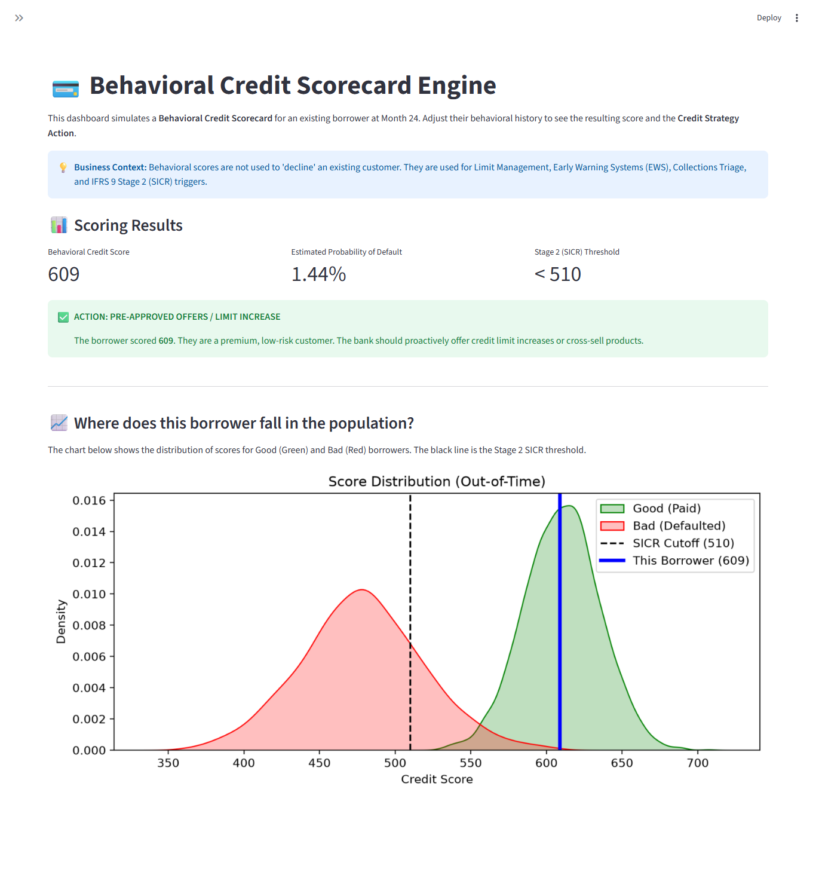
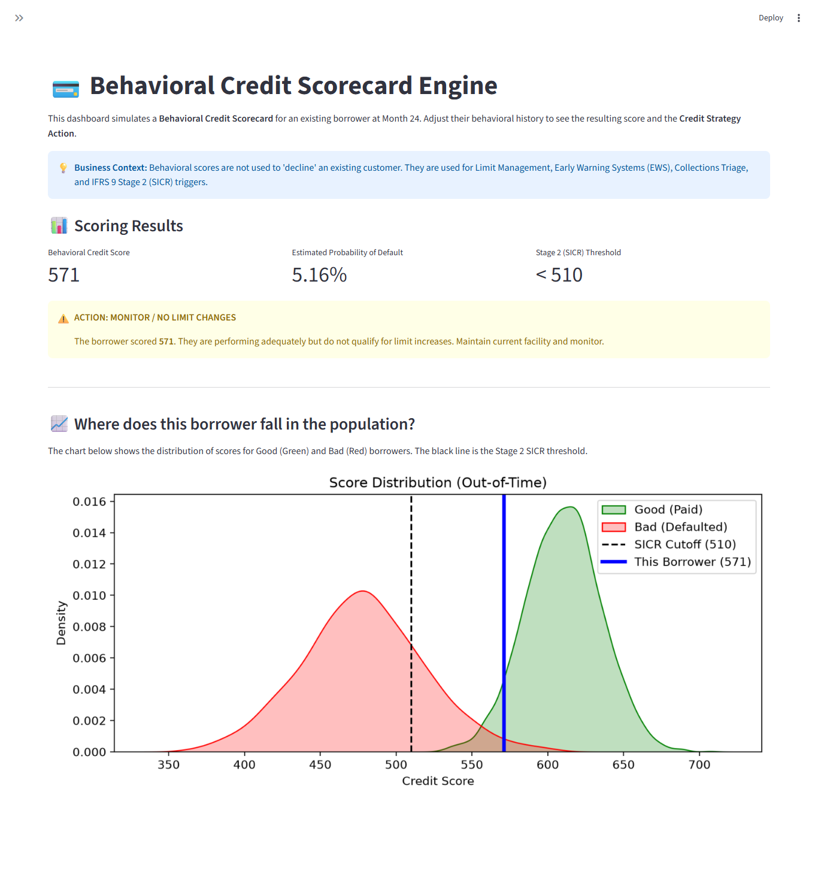
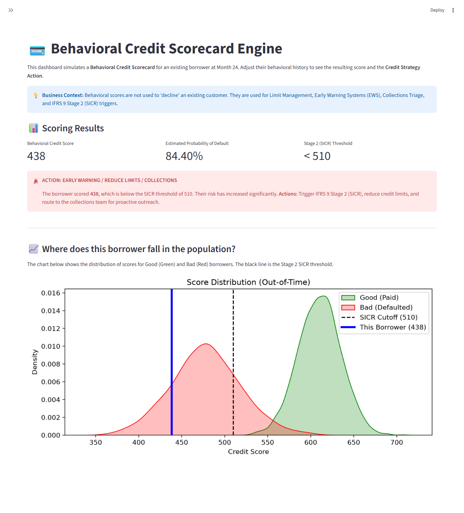
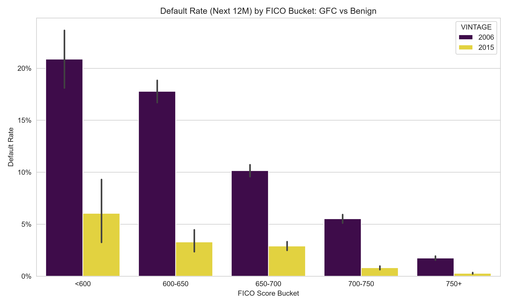
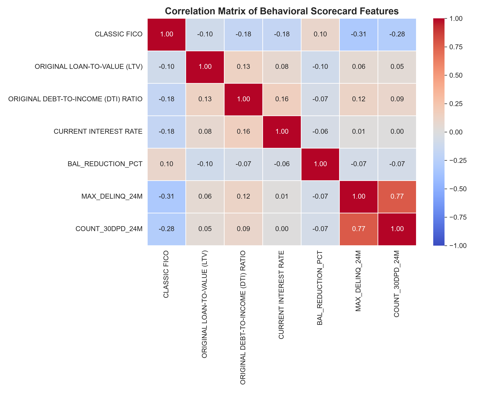
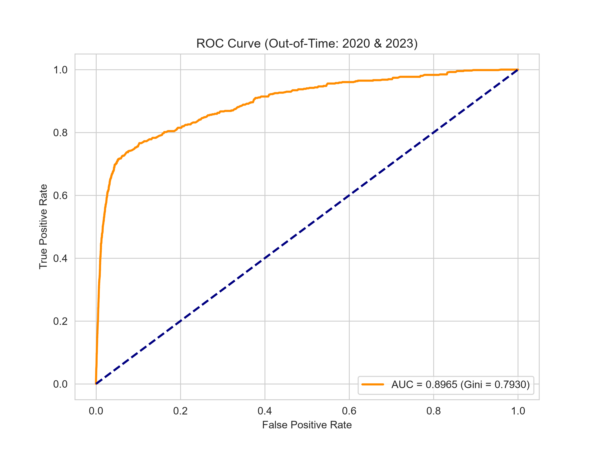
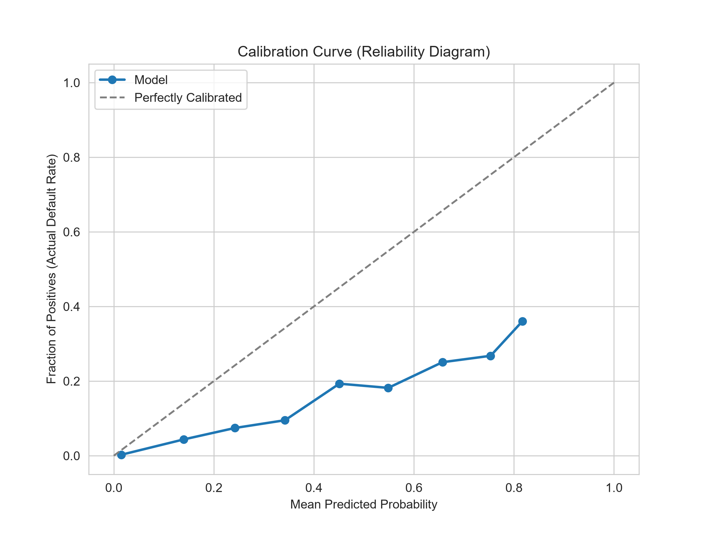
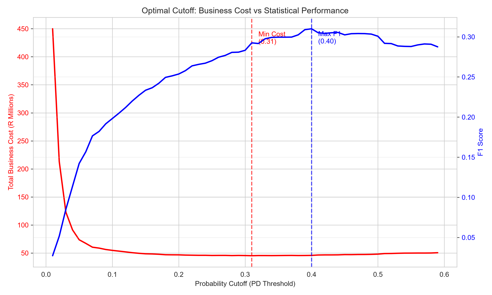
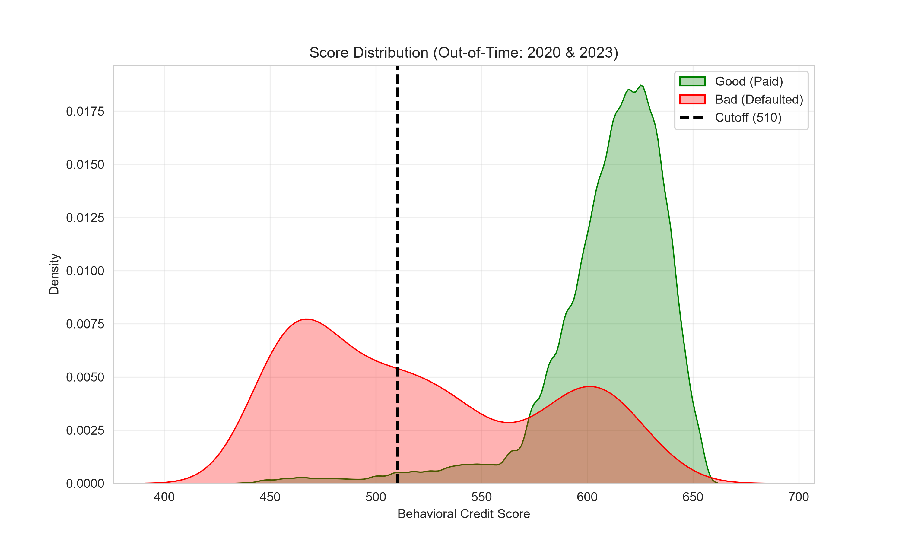

# Behavioral-Credit-Scorecard-Engine
An end-to-end Behavioral Credit Scorecard on 194K loan observations. Features WoE/IV transformation, Logistic Regression, and a business-cost optimal cutoff (Score: 510). Includes an interactive Streamlit app for real-time credit strategy deployment.

# Behavioral Credit Scorecard

An end-to-end machine learning pipeline for building a **Behavioral Credit Scorecard** on 194,000 loan observations. This project demonstrates how to predict forward 12-month default risk using backward-looking behavioral data (Months 1–24), applying the classical 10-step credit scoring framework.

## Overview
Unlike an Application Scorecard that uses static origination data, this model assesses existing borrowers. Using 5 distinct economic vintages from the Freddie Mac dataset (2006, 2008, 2015, 2020, 2023), the model observes a loan's behavior during its first 24 months of life to predict the probability of default in the following 12 months (Months 25–36).

## Model Performance & Validation
The model was built using the classical **Weight of Evidence (WoE)** and **Information Value (IV)** framework. It achieved elite Out-of-Time performance (tested on unseen 2020 & 2023 data).

> **Validation Rating: 9.4 / 10 (FIT FOR USE)** 
> 
> *   **Out-of-Time Gini:** **0.7930** (Top-tier for mortgage behavioral models)
> *   **KS Statistic:** **0.6643**
> *   **PSI (Stability):** **0.0970** (Green zone, highly stable across economic cycles)

📄 **[Click here to read the full Model Validation Report](behavioral_scorecard_validation_v1.md)**

## Interactive Dashboard
The Streamlit app simulates a **Behavioral Credit Scorecard** for an existing borrower. Instead of simply "Approving" or "Declining", this app demonstrates how banks use behavioral scores for **Account Management** and **IFRS 9 Staging**.

**1. Pre-Approved Offers / Limit Increase (High Score)**
The borrower exhibits pristine behavior. The bank should proactively offer limit increases or cross-sell products.

**2. Monitor / No Limit Changes (Borderline Score)**
The borrower shows minor risk signals. Maintain current facility and monitor closely.

**3. Early Warning / Collections (Low Score)**
The borrower has breached the SICR cutoff (Score < 510). The bank must trigger IFRS 9 Stage 2, reduce limits, and route to collections.

## Key Analytical Steps

### 1. Exploratory Data Analysis (Monotonicity Check)
Before modeling, we analyze the default rate across different FICO bands. A valid scorecard must exhibit monotonicity: as credit score increases, default rate must decrease. The chart below proves this economic relationship holds true, even when comparing the GFC (2006) vs. the Benign period (2015).

*Figure 1: Default Rate by FICO Bucket (GFC vs Benign).*

### 2. Multicollinearity Check
Features with high multicollinearity (like `COUNT_30DPD` and `MAX_DELINQ`, correlated at 0.77) were removed to ensure coefficient stability. 

*Figure 2: Correlation Matrix. We dropped COUNT_30DPD to prevent coefficient instability.*

### 3. Model Discrimination (ROC Curve)
The model cleanly separates good borrowers from bad borrowers on unseen data.

*Figure 3: ROC Curve (Out-of-Time). The AUC of 0.8965 proves the behavioral features have exceptional predictive power.*

### 4. Calibration & Validation
The model was tested for probability calibration. While it shows a slight over-prediction at high-risk bands (a common trait of high-IV delinquency features), the scorecard's primary purpose is *rank-ordering* (separating good from bad), which remains mathematically sound.

*Figure 4: Calibration Curve. Documented as a known limitation; does not impair scorecard rank-ordering.*

### 5. Business Cost Matrix & Cutoff Selection
A model is useless without a business strategy. We did not use a purely statistical cutoff. Instead, we applied a Cost Matrix assuming a False Negative (default) is 10x more expensive than a False Positive (lost margin).

*Figure 5: Business Cost vs Statistical Performance. The red line (Cost) bottoms out at a 31% probability threshold, while the blue line (F1) peaks at 40%. We prioritized the business cost.*

### 6. Final Score Distribution
The business-optimal 31% probability cutoff was translated into a **Credit Score of 510**.

*Figure 6: Score Distribution. A score of 510 perfectly slices the population, capturing the vast majority of defaults (Red) while allowing good payers (Green) to pass.*

## Model Deployment & MLOps
This repository provides two deployment artifacts:
1. **The Points Table (`behavioral_scorecard_points.csv`):** In a production banking environment, Behavioral Scorecards are deployed into core banking decision engines (like FICO or SAS) using a points table, rather than running a live Python model.
2. **The Trained Model (`behavioral_lr_model.joblib`):** The trained Scikit-Learn Logistic Regression model and WoE mappings are archived here for model validation, auditing, and reproduction purposes.

## The 10-Step Framework Used
1. Define the Objective (Predict Month 25-36 Default)
2. Collect Historical Data (5 Vintages)
3. Clean and Prepare Data (Audit Trail & Imputation)
4. Perform EDA (Distribution & Monotonicity Analysis)
5. Create Predictive Features (Utilization, Max Delinq)
6. Apply Weight of Evidence (WoE & IV)
7. Build Logistic Regression Model
8. Convert PD into Credit Score (PDO Scaling)
9. Validate Scorecard (AUC, Gini, KS, PSI, Calibration)
10. Implement & Monitor (Score: 510)

---
**Author:** Raymond Sibanda | [LinkedIn](https://www.linkedin.com/in/raymond-sibanda-91850613b) |
FRM | BSc Mathematics | BCom Honors Accounting
